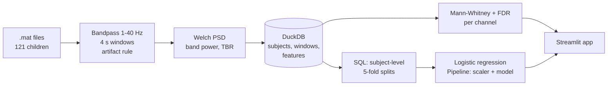

# Does the EEG theta/beta ratio separate children with ADHD from controls?

**Question.** Is the EEG theta/beta ratio (TBR) different in children with ADHD, and can band power
classify ADHD vs control on a public dataset?

**Answer (this dataset, 61 ADHD + 60 control children).**
- TBR is **lower** in ADHD than in control in all 19 channels, the opposite of the often-quoted
  "high TBR in ADHD". After Benjamini-Hochberg FDR across 19 channels, 3 channels remain significant:
  T7, P7 and Pz (rank-biserial r about -0.33 to -0.35, q about 0.01).
- Classification is weak to moderate. 5-fold subject-level cross-validated AUROC:

| Model | Features | AUROC (mean ± std over folds) | 95% CI (bootstrap over subjects) | Shuffled-label AUROC |
|---|---|---|---|---|
| A1 TBR, mean of channels | 1 | 0.634 ± 0.108 | 0.520 - 0.719 | 0.483 |
| A2 TBR, Cz only | 1 | 0.585 ± 0.085 | 0.465 - 0.681 | 0.508 |
| A3 TBR, all 19 channels | 19 | 0.553 ± 0.091 | 0.446 - 0.650 | 0.504 |
| B all band powers (log abs + rel) | 152 | 0.676 ± 0.135 | 0.575 - 0.767 | 0.440 |
| C 1D CNN on raw 4 s windows (stretch) | 19 x 512 | 0.792 ± 0.102 | 0.713 - 0.865 | 0.440 |

TBR alone is not a convincing classifier (A2 and A3 have CIs that include 0.5). Using all band powers
is somewhat better but still modest. The small CNN on raw windows scored higher (0.77 - 0.79 over three
training seeds), but I do not know why: it could be finer spectral or spatial detail, medication
effects or another recording difference between groups, so it is not evidence of a usable biomarker.
Nothing was tuned (CNN settings were fixed before running). This is a research demo, **not a diagnostic tool**.

## Pipeline



Code: `src/load.py`, `preprocess.py`, `features.py`, `build_db.py`, `stats.py`, `models.py`,
`export_app_data.py`, stretch: `cnn.py`, `pubmed_check.py`; SQL in `sql/`; tests in `tests/`.

## Literature check (PubMed)
`src/pubmed_check.py` searches PubMed (free NCBI API, no key, no LLM) and saves `data/literature_check.csv`
(32 papers). It is a list of search results, not a systematic review. Two meta-analyses it found:
[Arns et al. 2012](https://doi.org/10.1177/1087054712460087) reported higher TBR in ADHD at Cz with
heterogeneity, and concluded it is not a reliable diagnostic measure;
[Boxum et al. 2025](https://doi.org/10.1007/s10484-024-09649-y) concluded TBR has no diagnostic value.
Our result (lower TBR in ADHD, task EEG, medicated children) is therefore not a replication of high TBR.
(Information retrieved from PubMed.)

## How leakage was avoided
- **Split by subject, never by window.** The folds are built in SQL (`sql/splits.sql`): within each
  group, subjects are ordered by a seeded hash and dealt into 5 folds, so each child is in exactly one fold.
- Models are trained on one averaged row per child, and a test checks that no subject is in both
  train and test of any fold.
- The `StandardScaler` sits inside a scikit-learn `Pipeline`, so it is fit on training folds only
  (tested).
- A shuffled-label run lands near chance (0.44 - 0.51), as it should. The CNN trains on windows of training subjects only and its window predictions are averaged per child before scoring.
- Recording length was never used as a feature.

## Limitations
- **Task EEG, not resting EEG** (children counted cartoon characters), so results may not carry over to rest.
- **Recording length differs by group** (ADHD 155 s vs control 125 s on average) because the task ended when the child finished.
- **Medication:** the ADHD children had taken Ritalin for up to 6 months. This may explain the lower TBR, but it was not tested.
- **No age or sex** in the files, so neither was controlled for.
- **Units are undocumented** in the `.mat` files and amplitudes are large, so a fixed microvolt artifact
  threshold was impossible. Windows are dropped if the worst channel's peak-to-peak exceeds 3x that
  child's median (97.6% of windows kept in both groups). No ICA.
- **Small single dataset.** About 24 children per test fold, so AUROC varies a lot between folds.
- The `.mat` files carry no channel names or sampling rate. Channel order comes from the dataset's
  `Channel_Labels.docx` and 128 Hz from the dataset page.

## Run it
```
python3 -m venv .venv && .venv/bin/pip install -r requirements-pipeline.txt  # includes PyTorch (large)
# put the unzipped .mat files in data/raw/<zip name>/<zip name>/*.mat
.venv/bin/python -m src.build_db        # DuckDB tables, windows, features
.venv/bin/python -m src.stats           # splits, SQL views, group tests, figures
.venv/bin/python -m src.models          # models, CV, ROC figure
.venv/bin/python -m src.cnn             # stretch: 1D CNN (about 6 min on CPU)
.venv/bin/python -m src.pubmed_check    # stretch: literature table
.venv/bin/python -m src.export_app_data # small files for the app
.venv/bin/streamlit run app.py
.venv/bin/pytest -q
```

## Data and citation
Nasrabadi, A. M., Allahverdy, A., Samavati, M., Mohammadi, M. R. *EEG data for ADHD / Control
children.* IEEE DataPort, 2020. doi: [10.21227/rzfh-zn36](https://doi.org/10.21227/rzfh-zn36).
Licence: CC BY per IEEE DataPort's terms (attribution required). Raw data is not in this repo (`data/raw/` is gitignored). Download it from IEEE DataPort (free login).

## Live demo
https://adhd-eeg-tbr-chv8g9ka9vtqxgo2mpnt8v.streamlit.app/ (research demo, not a diagnostic tool)

## Deploy checklist (Streamlit Community Cloud)
- [x] **Dataset licence:** IEEE DataPort's [FAQ](https://ieee-dataport.org/faq/who-owns-datasets-ieee-dataport) says uploaded datasets are available under CC BY, which allows sharing derived data with attribution. The dataset page itself shows no licence line, so the version is unconfirmed. Keep the citation below in the README and app.
- [ ] Commit only: `app.py`, `requirements.txt`, `data/app_features.parquet`, `data/app_group_stats.csv`, `data/app_model_results.csv`, `data/literature_check.csv`, `figs/roc.png`, and the code. Do not commit `data/raw/`, `data/eeg.duckdb` or `.venv/`.
- [ ] Push to a public GitHub repo (this folder is not a git repo yet).
- [ ] On share.streamlit.io: new app, pick the repo, main file `app.py`.
- [ ] Open the live app, click through all four pages, then paste the URL above.
